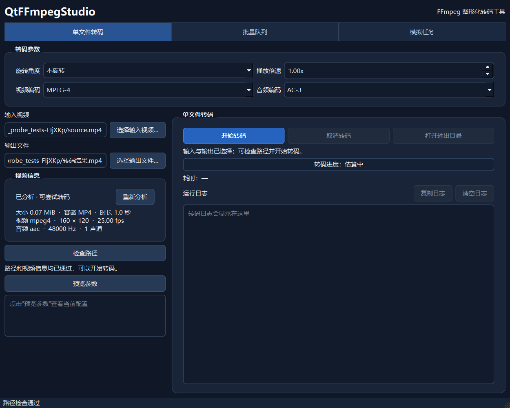
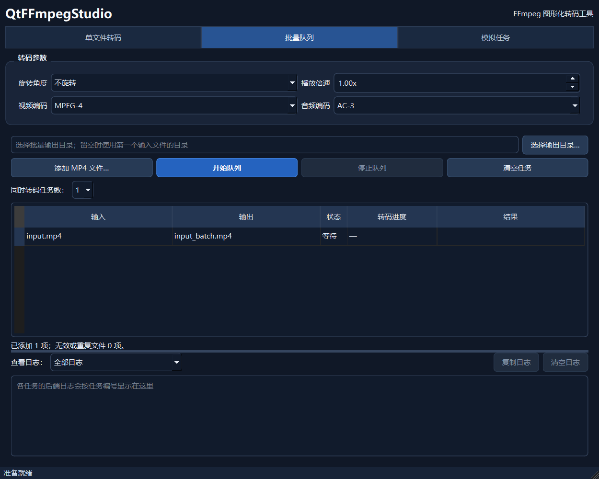
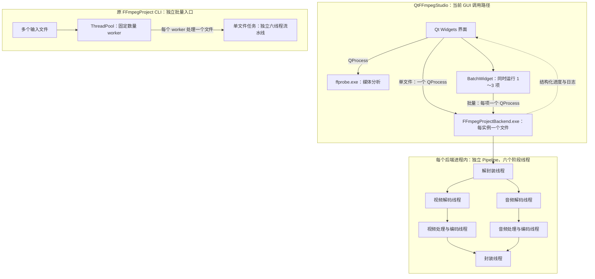

# QtFFmpegStudio

基于 C++17、Qt Widgets 和 FFmpeg 的 Windows 桌面视频转码工具。支持单文件转码、批量队列、媒体信息分析、取消任务和转码进度显示。Qt 界面通过 `QProcess` 管理独立后端进程，批量任务最多同时运行 3 个。

以下截图由项目的 Qt 测试程序在 Windows 11 上截取，使用测试素材。

| 单文件转码 | 批量队列 |
| --- | --- |
|  |  |

## 使用方法

1. 在“单文件转码”页选择带视频和音频流的 MP4，等待视频信息分析完成。
2. 选择输出 `.mp4` 路径，设置旋转、倍速及音视频编码器，点击“开始真实转码”。
3. 查看整体估算进度、耗时和日志；成功后“本次转码结果”显示编码设备、处理速度、输出大小及 mux 耗时分布，并可打开输出目录。
4. 批量处理时切到“批量队列”，设置输出目录，添加多个 MP4，选择同时运行的任务数（1～3），再启动队列。点击任务行可查看该任务的保存设置、结果和日志。

## 功能

- 选择 MP4 输入和输出文件，设置旋转角度、播放倍速、视频编码器（MPEG-4 / H.264）与音频编码器（AC-3 / AAC）。
- 选择输入后异步分析视频信息，显示文件大小、时长、编码、分辨率、帧率和音轨信息；单文件转码需等待当前输入分析通过且含有音视频流。分析超时或失败会提示原因，并可点击“重新分析”。
- 批量添加任务，设置同时运行的任务数（1～3），分别查看任务状态、进度、耗时和日志。
- 显示整体转码进度；支持取消运行中的任务，并清理本次任务创建的临时输出。
- 复制、清空日志，保存常用设置；单文件成功后可打开输出目录。

**支持范围：**当前处理带视频和音频流的 MP4，输出为 MP4；支持 MPEG-4/H.264 视频和 AC-3/AAC 音频输出。无音轨视频、其他容器、多音轨选择和字幕处理尚未实现。倍速通过采样选择改变播放时长，也会改变音调。进度依据封装阶段时间戳估算，运行中最高显示 99%，成功完成后显示 100%。

画质可选原有默认、高画质、均衡、小体积或指定视频目标码率。目标码率控制的是视频编码，实际文件大小还受素材内容、音频码率和封装开销影响，不保证精确大小。分辨率可保持原尺寸，或将旋转后的短边限制为 720 / 1080 像素，按比例缩小且不放大小尺寸素材。帧率可保持原始值或设为 24 / 25 / 30 / 60 fps；指定帧率时按输入帧率和播放倍速选取或复制帧。当前以输入流标称帧率采样，变帧率素材的逐帧时间间隔不予保留。新设置在添加批量任务时随任务保存。

## 实现结构



`MainWindow` 处理单文件操作；`BatchWidget` 与 `BatchTaskModel` 管理队列状态；`BackendProcess` 负责进程启动、输出解析和取消。GUI 实现集中在 `QtFFmpegStudioGui` 静态库，由主程序和相关测试共同链接，避免同一批源文件重复编译。每个后端任务拥有独立的音视频队列与六个流水线线程。后端通过标准输出发送结构化进度和日志，GUI 异步更新界面。取消和失败时清理本次任务的临时输出，成功后再发布最终文件。

线程池属于原 `FFmpegProject` CLI 的文件级并发设计：固定 worker 从任务队列领取文件，每个文件再运行自己的六线程流水线。当前 Qt GUI 的批量并发由 `BatchWidget` 限制后端进程数量；仓库中保留了 `backend/src/thread_pool.cpp`，但 `backend/main.cpp` 当前没有实例化 `ThreadPool`。图中将两个独立入口分别标出，避免把 GUI 的进程调度画成线程池。

## 构建与运行

当前项目面向 Windows，已在 Windows 11、CMake 3.27+、Ninja、Qt 6.8.3 Widgets、Qt 配套 MinGW 13.1 和 FFmpeg 4.4 shared SDK 上构建与测试。`ninja.exe` 需要在 `PATH` 中，也可通过 `-DCMAKE_MAKE_PROGRAM=...` 指定 CLion 自带的 Ninja。SDK 需要包含 `include/`、`lib/`、`bin/ffprobe.exe` 和 `bin/ffmpeg.exe`。第三方文件不在源码仓库中。

以下命令中的路径请改成实际安装位置。`FFMPEG_ROOT` 未指定时默认查找 `../FFmpegProject/ffmpeg-4.4-full_build-shared`。

```powershell
$env:PATH = 'D:\Qt\Tools\mingw1310_64\bin;D:\Qt\6.8.3\mingw_64\bin;' + $env:PATH
cmake -S . -B build -G Ninja -DCMAKE_C_COMPILER=D:/Qt/Tools/mingw1310_64/bin/gcc.exe -DCMAKE_CXX_COMPILER=D:/Qt/Tools/mingw1310_64/bin/g++.exe -DCMAKE_PREFIX_PATH=D:/Qt/6.8.3/mingw_64 -DFFMPEG_ROOT=D:/path/to/ffmpeg-4.4-full_build-shared
cmake --build build --parallel 4
ctest --test-dir build --output-on-failure --parallel 4
```

构建后运行 `build/QtFFmpegStudio.exe`。`FFmpegProjectBackend.exe`、`ffprobe.exe` 和所需 DLL 会复制到构建目录。也可以在 CLion 中配置相同的 CMake 选项，构建并运行 `QtFFmpegStudio` 目标。

### NVENC H.264 第一阶段

独立后端可用 `-vbackend nvenc` 选择 NVIDIA 硬件编码；视频编码格式须同时指定为 H.264。默认 `-vbackend software`，原 MPEG-4/H.264 软件编码路径继续可用。

```powershell
.\build\FFmpegProjectBackend.exe -i .\input\input.mp4 -o .\output\nvenc.mp4 -vcodec h264 -vbackend nvenc -acodec aac -rotate 90 -speed 2
```

本阶段保留 CPU 解码、旋转、倍速和音频处理。Qt 界面的“视频编码设备”可选 CPU（软件编码）或 GPU（NVIDIA NVENC）；选择 GPU 时自动使用 H.264，选择 MPEG-4 时自动切回 CPU。设备选项旁显示 NVENC 可用性，点击“重新检测”会让独立后端尝试初始化 `h264_nvenc`。检测结果仅反映检测时的环境；即使检测失败，GPU 选项仍可选，以便环境恢复后重试。单文件和批量任务都通过现有 QProcess 向独立后端传递选择。运行需要支持 NVENC 的 NVIDIA 显卡、驱动及包含 `h264_nvenc` 的 FFmpeg 库，不需要为此单独安装 CUDA Toolkit。

## 验证

项目使用 Qt Test / CTest 覆盖参数、媒体分析、单文件与批量转码、取消、输出保护、进度和日志。当前测试列表为 11 项；请在自己的构建环境运行上面的 `ctest` 命令确认结果。

转码输出还可用以下脚本检查流信息、时长、完整解码、短静音和旋转方向：

```powershell
powershell -File .\scripts\verify_transcode_correctness.ps1 -BuildDirectory .\build -FfmpegRoot D:\path\to\ffmpeg-4.4-full_build-shared
```

脚本使用 FFmpeg 生成合成素材；结果保存在构建目录的 `correctness-日期时间/` 下。测量结果与适用范围见[转码正确性验证记录](verification/2026-10-26-transcode-correctness.md)。这些自动检查不能代替真实视频的人工试听、播放和另一台 Windows 电脑上的分发包验收。

后端日志现在会显示 mux 等待音视频包、写包和固定休眠等耗时。可复现的 CPU/NVENC 对比方法与结果见 [Mux 性能测量](verification/2026-10-27-mux-performance.md)，脚本为 `scripts/measure_mux_performance.ps1`。

## 打包

```powershell
powershell -File .\scripts\package.ps1 -BuildDirectory .\build -QtBin D:\Qt\6.8.3\mingw_64\bin -MinGWBin D:\Qt\Tools\mingw1310_64\bin
```

脚本调用 `windeployqt`，将 GUI、后端、`ffprobe.exe` 及运行依赖放入 `dist/QtFFmpegStudio-日期时间/`。源码仓库不包含构建和打包产物；请在目标 Windows 机器上单独验证打包结果。打包后的可执行文件为 `QtFFmpegStudio.exe`。本机全新检出构建与候选包烟测记录见[交付检查](verification/2026-10-26-v1-showcase.md)。

## 仓库目录

| 目录 | 内容 |
| --- | --- |
| `src/` | GUI、任务模型、进度解析和后端进程管理 |
| `backend/` | FFmpeg 转码流水线及独立进程入口 |
| `tests/` | Qt 界面、批量队列、真实转码与输出保护测试 |
| `scripts/` | Windows 打包脚本 |
| `verification/` | 可复现的输出正确性记录与已知边界 |
| `assets/screenshots/` | Qt 界面截图 |

`input/`、`output/`、`dist/` 和构建目录属于本地数据或产物，不提交到仓库。
