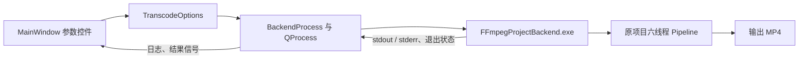

# 第五课：用 QProcess 调用自己的 FFmpeg 后端

这一课使前四课的界面第一次执行真实转码。窗口下方分为“模拟任务”和“真实转码”两个页签；请选“真实转码”操作。真实页显示后端日志和结果，不使用第四课的模拟百分比。

## 一、先在 CLion 运行

1. 关闭当前正在运行的旧 QtFFmpegStudio 窗口，否则 Windows 可能禁止构建程序覆盖 exe。
2. 重新加载 CMake 项目并 Build。构建 `QtFFmpegStudio` 目标会先构建自己的 `FFmpegProjectBackend.exe`；两个 exe 及所需 DLL 会放在同一个构建目录。
3. 选择一个**同时有视频和音轨**的 MP4，再选择不同的输出 MP4 路径。
4. 初次使用先保持 0°、1.00x、MPEG-4、AC-3。点击“开始真实转码”，观察日志和最终状态。
5. 输出文件生成后，用播放器打开它；若文件已存在，界面会先询问是否覆盖。

本项目当前的后端使用原 FFmpegProject 流水线，只处理含视频和音频两路的输入。真实页没有精确百分比，因为现有流水线尚未提供可靠的全流程进度协议；后端日志里即使出现“Demux 进度”，它也只是读取输入的阶段信息。

## 二、数据从哪里走



对照[backendprocess.cpp](../../src/backendprocess.cpp)阅读：`setProgram()` 只指定可执行程序，`setArguments(QStringList)` 逐项传入 `-i`、输入路径、`-o`、输出路径和四个参数。路径里有空格时仍是一个参数；不用自己拼 shell 命令。`start()` 后立刻返回，窗口继续处理事件。`readyReadStandardOutput` 和 `readyReadStandardError` 信号到来时再读日志。[Qt 的 QProcess 文档](https://doc.qt.io/qt-6.8/qprocess.html)列出了这些信号与异步接口。

后端按 UTF-8 写日志。一个 `readyRead` 数据块可能只包含半个中文字，所以 BackendProcess 保留 `QStringDecoder` 的状态连续解码；窗口按收到的原样文本追加到只读日志框。两个流各有自己的解码器，避免数据块之间把字符拆坏。[QStringDecoder 文档](https://doc.qt.io/qt-6.8/qstringdecoder.html)说明了按块解码的状态行为。

## 三、为什么新建 backend 目录

原 [FFmpegProject](https://github.com/Promisein/FFmpegProject) 当时的 CLI 固定扫描 `../input`，不能让 GUI 指定任意输入输出。第五课从原项目当前工作区复制了 16 个项目头文件和 13 个源文件到 `backend`，并在副本里添加入口与输出路径参数；原项目未被这一步修改。复制时原项目已有未提交改动，因此本目录的副本是当时工作区内容的快照，后续不要假定会自动跟随原项目更新。

关键文件是 [backend/main.cpp](../../backend/main.cpp)、[backend/include/transcode.h](../../backend/include/transcode.h) 和 [backend/src/transcode.cpp](../../backend/src/transcode.cpp)：

- `backend/main.cpp` 解析 `-i`、`-o`、`-rotate`、`-speed`、`-vcodec`、`-acodec`，再调用 `transcode_single()`。
- `transcode_single()` 仍使用原有 demux、双路 decode、双路 encode、mux 六个阶段线程。本课仅把输出目标从固定 `output.mp4` 改为传入的 `output_path`。
- Windows 的 `wmain` 接收宽字符路径，再转成 UTF-8 交给 FFmpeg，以保留中文和空格路径。
- 已存在的输出必须显式加 `--overwrite`。GUI 只有在你点“确认覆盖”后才会传这个选项。后端也会拒绝输入与输出是同一文件的情况，包括通过硬链接使用不同文件名。

后端退出码约定：`0` 表示任务报告成功，`1` 表示转码阶段失败，`2` 表示命令参数或路径校验失败。界面还会确认输出文件存在且非空，才显示成功。

## 四、界面状态怎样恢复

看 [mainwindow.cpp](../../src/mainwindow.cpp) 的 `startRealTranscode()`、`cancelRealTranscode()` 和 `closeEvent()`。

启动前复用第四课的 `validatePaths()`；若输出已存在，先弹出覆盖确认。运行中“开始真实转码”、模拟启动、文件选择和参数控件暂时禁用，“取消转码”可以点击。成功、失败或取消后，按钮恢复；日志和结果留在界面中供你查看。

取消时，GUI 先请求子进程结束；若三秒后仍在运行，再强制结束。运行中关闭窗口会先询问，确认后等待后端实际退出再关闭窗口。这避免在进程仍运行时直接销毁 QProcess。第七课起，后端先写同目录的 `QFS*.tmp` 临时文件，成功后才发布最终输出；强制取消可能留下临时文件，界面不会将任务报告为成功。

CMake 构建后会把 FFmpeg 运行 DLL 与 MinGW 运行库复制到 exe 所在目录；界面用 `QProcessEnvironment` 把应用目录加入后端进程的 PATH。`FFMPEG_ROOT` 在项目 CMake 中默认指向兄弟目录的现有 SDK，可在 CMake 配置时覆盖。[Qt 文档](https://doc.qt.io/qt-6.8/qprocessenvironment.html)说明了子进程环境变量的设置。分发到另一台电脑时，还需核对 Qt 平台插件等部署依赖，本课只验证当前开发环境。

## 五、自己验证和练习

本轮在本机生成了带视频和音轨的短 MP4，验证了中文空格路径的转码。默认 MPEG-4/AC-3 与 90°、1.25x、H.264/AAC 两组输出都生成成功，`ffprobe` 能识别视频与音频流。对已有目标不给 `--overwrite` 时，后端返回错误且文件哈希不变。Qt 的端到端测试还覆盖真实成功、损坏输入失败、取消、硬链接同文件保护及前几课回归。

你可以在项目根目录的 PowerShell 中重新运行：

```powershell
$env:PATH = 'D:\QT\6.8.3\mingw_64\bin;D:\QT\Tools\mingw1310_64\bin;' + $env:PATH
& 'D:\CLion 2023.3.6\bin\cmake\win\x64\bin\cmake.exe' --build .\cmake-build-codex-lesson4
& 'D:\CLion 2023.3.6\bin\cmake\win\x64\bin\ctest.exe' --test-dir .\cmake-build-codex-lesson4 --output-on-failure
```

两个练习：

1. 在 `startRealTranscode()` 找到现有文件的覆盖确认逻辑。试着选择一个已存在的输出，点“否”，确认文件没有变化，并解释为什么后端还需要独立检查 `--overwrite`。
2. 选择一个损坏的 MP4 或不含音轨的 MP4，观察日志、退出状态和按钮恢复。试着指出后端在哪里报告失败，界面在哪里接收结果。

这节课的完整结果仍应由你在 CLion 中用自己的视频实际播放检查。下一课再做运行状态、配置保存与部署方面的完善，不把本轮的 Demux 百分比当作真实转码进度。
